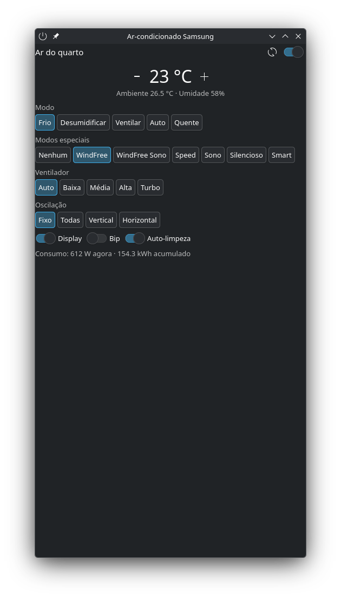

# Ar-condicionado Samsung — plasmoid para KDE Plasma 6

Widget de painel que controla um ar Samsung via API da SmartThings: liga/desliga,
temperatura, modo, ventilador, **WindFree** e demais modos especiais, oscilação,
display, bip, auto-limpeza, sensores e consumo. Os controles aparecem só se o
seu modelo expõe a capability correspondente.

Na barra: **clique** abre o popup, **clique do meio** liga/desliga, **rolar** ajusta a temperatura.



## Requisitos

- KDE Plasma 6
- Python 3 (só biblioteca padrão)
- Node.js (apenas uma vez, para criar o app OAuth com `npx`)
- Ar-condicionado Samsung já cadastrado no app SmartThings

## Instalação

```sh
git clone https://github.com/DarkTiengo/plasma-samsung-ac.git
cd plasma-samsung-ac
kpackagetool6 -t Plasma/Applet -i samsung-ac     # primeira vez
kpackagetool6 -t Plasma/Applet -u samsung-ac     # para atualizar (após git pull)
```

Depois: botão direito no painel → *Adicionar widgets* → "Ar-condicionado Samsung".
(Se o Plasma não enxergar a atualização: `systemctl --user restart plasma-plasmashell`.)

## Autorização (uma vez)

Os Personal Access Tokens da SmartThings expiram em 24 h, então o widget usa
OAuth com refresh token automático.

1. Crie um app OAuth com o CLI oficial (abre o navegador para login na conta Samsung):
   ```sh
   npx @smartthings/cli apps:create
   ```
   - Tipo: **OAuth-In App**
   - Nome/descrição: qualquer um (ex.: "Plasma AC")
   - Target URL: deixe em branco
   - Scopes: **r:devices:\*** e **x:devices:\***
   - Redirect URI: **https://httpbin.org/get**

   Anote o *OAuth Client Id* e o *OAuth Client Secret* exibidos no final (o secret só aparece uma vez).
   Se o CLI já estiver logado numa conta Samsung diferente, apague `~/.config/@smartthings/cli` antes.
2. No widget: botão direito → *Configurar…*, preencha Client ID, Client Secret e
   Redirect URI, clique **1. Abrir página de autorização**, faça login e autorize.
3. O navegador cai no httpbin mostrando `"code": "..."`. Cole o code (ou a URL / a página inteira)
   no campo *Code* e clique **2. Concluir autorização**.
4. Escolha o aparelho e clique *Aplicar*.

> Dica: abra a página de autorização numa janela anônima se o navegador já estiver logado
> em outra conta Samsung — senão ele autoriza a conta errada e a lista de aparelhos vem vazia.

Tokens ficam em `~/.config/samsung-ac-plasmoid/auth.json` (permissão 600). O refresh token
vale 30 dias e é renovado a cada uso — só expira se o widget ficar 30 dias sem rodar.

## Depuração pelo terminal

```sh
S=samsung-ac/contents/code/stctl.py
python3 $S devices                    # lista aparelhos
python3 $S status <deviceId>          # estado normalizado que o widget usa
python3 $S raw <deviceId>             # status cru da API
python3 $S describe <deviceId>        # comandos de cada capability do seu modelo
python3 $S cmd <deviceId> custom.airConditionerOptionalMode setAcOptionalMode '["windFree"]'
```

Se algum controle não funcionar no seu modelo (ex.: display ou bip), rode `describe`
e ajuste o nome do comando em `contents/ui/main.qml` / `FullRepresentation.qml`.
Issues e pull requests com o mapeamento de outros modelos são bem-vindos.

## English

KDE Plasma 6 panel widget for Samsung Wi‑Fi air conditioners through the SmartThings API
(power, setpoint, mode, fan, **WindFree** and other optional modes, swing, display, beep,
auto-clean, sensors, energy). Install with `kpackagetool6 -t Plasma/Applet -i samsung-ac`,
create an OAuth-In app with `npx @smartthings/cli apps:create` (scopes `r:devices:*`,
`x:devices:*`, redirect `https://httpbin.org/get`), then authorize from the widget settings.
Tokens refresh automatically and are stored in `~/.config/samsung-ac-plasmoid/auth.json`.

## Licença

GPL-2.0-or-later — veja [LICENSE](LICENSE).
